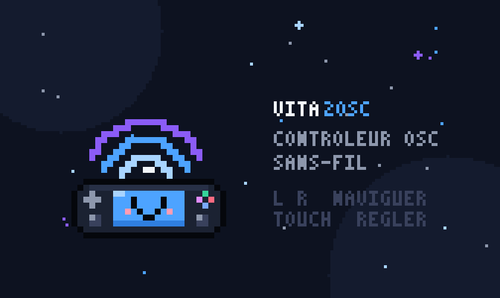

# Vita2OSC

> Homebrew PS Vita qui transforme la console en contrôleur OSC sans-fil, avec une webapp companion pour configurer les mappings à distance.

  

**[Releases (VPK)](https://github.com/elisalien/vita2osc/releases)**

<p align="center"></p>

## À propos

Vita2OSC fait de la PS Vita une surface de contrôle **OSC** complète et générique : tous les contrôles physiques et capteurs de la console (boutons, sticks, tactile avant/arrière, mouvement) sont émis en OSC/UDP sur le réseau Wi-Fi. Une **webapp companion** permet d'éditer la configuration OSC et de la pousser sans-fil vers la Vita.

Compatible TouchDesigner, Resolume, Max/MSP, Chataigne, Ableton (via OSC), etc.

## Fonctionnalités

- Émission OSC/UDP de tous les contrôles Vita (boutons, sticks, tactile, mouvement)
- **UI "glasscore"** (vita2d) : rail de navigation tactile à icônes, transitions animées, toasts de feedback, batterie/réseau en direct, splash screen pixel art
- Pages visuelles : console interactive (Boutons), pads XY avec zone morte (Sticks), zones tactiles avant/arrière, barres bipolaires + horizon (Mouvement)
- **Réglage de l'IP/port directement sur la console** : clavier tactile officiel (IME) en touchant un champ ou avec △, ou ajustement fin au D-pad (appui long = répétition)
- Page **Couleurs** : effets Colorize & Dreamy Glow, sliders H/S/B/Alpha tactiles, toggles par groupe
- **Webapp companion** (`webapp/index.html`) : édition de la config, presets, import/export JSON
- Serveur HTTP embarqué sur la Vita (port 8080) : `GET/POST /config`, `POST /osc`, `GET /status`
- Persistance de la config sur `ux0:data/vita2osc/config.json`
- Icône + LiveArea en **pixel art** (générés par `tools/gen_pixelart.py`, embarqués dans le VPK)

## Installation

### Prérequis

- PS Vita en custom firmware (HENkaku / Enso)
- [VitaSDK](https://vitasdk.org/) installé (`VITASDK` défini), avec **vita2d**
- CMake ≥ 3.10 et `make`

Le script [`tools/install_vitasdk.sh`](tools/install_vitasdk.sh) télécharge et installe la toolchain VitaSDK dans `/usr/local/vitasdk`.

### Build

```bash
mkdir build && cd build
cmake ..
make
```

Le fichier `build/Vita2OSC.vpk` est généré. Copie-le sur la Vita (FTP via VitaShell ou clé USB) et installe-le via **VitaShell**, puis lance **Vita2OSC** depuis le LiveArea.

Voir [README_BUILD.md](README_BUILD.md) pour le guide détaillé (arborescence, notes de fiabilité, checklist de test sur matériel).

## Utilisation

1. Lance **Vita2OSC** sur la Vita → page **Réglages** → note l'IP locale
2. Règle la cible OSC directement sur la console (clavier tactile : toucher le champ IP ou △), ou depuis la webapp
3. Sur ton PC (même Wi-Fi), ouvre `webapp/index.html` (ou `python3 -m http.server` dans `webapp/` si le navigateur bloque les requêtes depuis `file://`)
4. Saisis l'IP de la Vita, **Récupérer la config** (ou charge un preset), édite les contrôles (adresse OSC, type, min/max, deadzone, lissage, mode…)
5. **Envoyer à la Vita** pour appliquer à chaud — la config est sauvegardée sur la carte mémoire

**Navigation Vita :** L/R ou toucher le rail gauche = pages · maintenir SELECT+START = quitter

Au premier lancement, la config par défaut (preset TouchDesigner, port 9000) est utilisée.

### Presets OSC

Des presets de référence sont dans [`presets/`](presets/) :

| Fichier | Usage |
|---|---|
| `preset_touchdesigner.json` | TouchDesigner (adresses `/vita/...`, port 9000) |
| `preset_resolume.json` | Resolume, composition **OSC2Vita** — adresses natives `/composition/...`, sans Edit OSC |
| `preset_resolume_osc2vita.json` | Identique à `preset_resolume.json` |
| `preset_resolume_generic.json` | Resolume générique `/vita/...` + apprentissage manuel (Edit OSC) |

Avant usage, remplace `target.ip` par l'IP de la machine qui reçoit l'OSC. Détails de branchement : [presets/README_PRESETS.md](presets/README_PRESETS.md) et [presets/COMPOSITION_OSC2VITA.md](presets/COMPOSITION_OSC2VITA.md).

## Structure du projet

```
├─ CMakeLists.txt     # build VitaSDK -> VPK
├─ src/               # app Vita : OSC, réseau, entrées, mapping, config/JSON, stockage, serveur HTTP, UI, thèmes
├─ sce_sys/           # icône + LiveArea pixel art
├─ webapp/index.html  # webapp companion (éditeur de config)
├─ presets/           # presets OSC (TouchDesigner, Resolume) + docs
├─ tools/             # install VitaSDK, génération du pixel art
├─ README_BUILD.md    # guide de build détaillé
└─ PLAN_DE_TRAVAIL.md # plan de travail complet
```

## Stack technique

C · VitaSDK · vita2d · CMake · OSC 1.0 sur UDP · HTTP/JSON · webapp HTML/JS · Python (génération des assets)

## Crédits & licence

Projet d'Élisalien.

Aucune licence n'est spécifiée — tous droits réservés.

---

<p align="center">
  Fait par <a href="https://github.com/elisalien">Élisalien</a> ·
  <a href="https://gitlab.com/elisalien/catalog">Catalogue des shaders, sources & logiciels</a>
</p>
